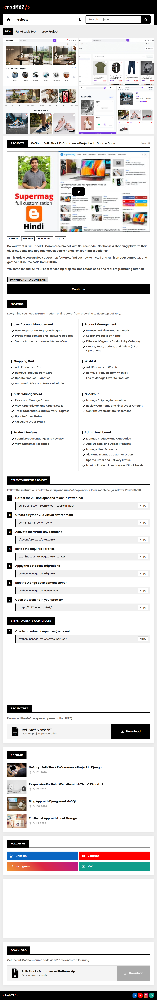

    
  </head>
  <body>
    <main class="readme-page">
      <header class="page-header">
        <h1>Blogger Template</h1>
        

          
            License
            MIT
          
          
            Responsive
            100%
          
          
            SEO
            Optimized
          
        

      </header>

      <figure class="preview-frame">
        
      </figure>

      <section class="intro" aria-label="About this template">
        

          Your blog design is the first thing visitors notice when they open
          your website. This <strong>Blogger Template</strong> offers a clean
          and simple design that is easy to customize.
        

        

          Whether you are a blogger, developer, student, or content creator,
          this template helps you build a professional-looking blog that suits
          your needs.
        

        <ul class="intro-list">
          <li>
            ➜ A clean, professional look that keeps your content front and
            center
          </li>
          <li>
            ➜ A layout that adapts nicely to phones, tablets, and desktops
          </li>
          <li>➜ SEO-friendly markup, so search engines can find your posts</li>
          <li>➜ Easy customization, with no coding headaches</li>
        </ul>
        

          Welcome to tedMXZ, your place for coding projects, free source code,
          and hands-on programming tutorials.
        

      </section>

      <section aria-labelledby="features-heading">
        <h2 class="section-heading" id="features-heading">Features</h2>
        

          Everything you need to run a modern, fast, and good-looking blog.
        

        

          <article class="feature-card">
            <h3>Clean Layout</h3>
            
Organized, professional layout built around your content.

            <ul class="feature-list">
              <li>✓ Clear content hierarchy</li>
              <li>✓ Readable typography</li>
              <li>✓ Minimal, distraction-free design</li>
            </ul>
          </article>

          <article class="feature-card">
            <h3>Responsive Design</h3>
            
Looks right on every screen, ultra-wide to foldable.

            <ul class="feature-list">
              <li>✓ Mobile, tablet, and desktop ready</li>
              <li>✓ Flexible grid and images</li>
              <li>✓ Tested on modern browsers</li>
            </ul>
          </article>

          <article class="feature-card">
            <h3>SEO-Friendly</h3>
            

              Semantic HTML that helps search engines understand your posts.
            

            <ul class="feature-list">
              <li>✓ Proper heading structure</li>
              <li>✓ Clean, crawlable markup</li>
              <li>✓ Fast-loading, lightweight code</li>
            </ul>
          </article>

          <article class="feature-card">
            <h3>Easy Customization</h3>
            
Make the design yours without touching the core.

            <ul class="feature-list">
              <li>✓ Colors and fonts</li>
              <li>✓ Spacing and layout elements</li>
              <li>✓ Blogger theme designer support</li>
            </ul>
          </article>

          <article class="feature-card">
            <h3>Widget Zones</h3>
            
Ready-made spots for what matters to your audience.

            <ul class="feature-list">
              <li>✓ Ads and sponsored blocks</li>
              <li>✓ Newsletter signup</li>
              <li>✓ Calls to action</li>
            </ul>
          </article>

          <article class="feature-card">
            <h3>Dark Mode</h3>
            
Comfortable reading at any time of day.

            <ul class="feature-list">
              <li>✓ Dark mode fallback in base styles</li>
              <li>✓ Readable contrast</li>
              <li>✓ Respects visitor preference</li>
            </ul>
          </article>

          <article class="feature-card">
            <h3>Accessibility</h3>
            
Built with every reader in mind.

            <ul class="feature-list">
              <li>✓ WCAG 2.1 AA focused</li>
              <li>✓ Semantic structure</li>
              <li>✓ Keyboard-friendly navigation</li>
            </ul>
          </article>

          <article class="feature-card">
            <h3>Organized Code</h3>
            
Easy to maintain and improve later.

            <ul class="feature-list">
              <li>✓ Atomic CSS approach</li>
              <li>✓ Multi-language ready structure</li>
              <li>✓ Commented, tidy source</li>
            </ul>
          </article>
        

      </section>

      <section class="support-section" aria-labelledby="support-heading">
        <h2 id="support-heading">Support the Project</h2>
        
If you like this project, follow me and star this repository.

        

          <a
            class="support-link"
            href="YOUR_GITHUB_PROFILE_LINK"
            target="_blank"
            rel="noopener noreferrer"
          >
            Follow on GitHub
          </a>
          <a
            class="support-link"
            href="YOUR_GITHUB_REPO_LINK"
            target="_blank"
            rel="noopener noreferrer"
          >
            Star this repository
          </a>
        

        

          Your support keeps this project growing. Thank you!
        

      </section>
    </main>
